# 🌬️ Modular Arctic Wind Turbine Architecture (50 kW)

[](https://github.com/stellardreams/modular-arctic-wind/actions/workflows/ci.yml)
[](#)
[](#)
[](#)

> [!NOTE]
> ### 🧭 Ecosystem Scope & Companion Inventions (`AMU`, `CORA-M`, `STRIDER-M`)
> This standalone repository (`modular-arctic-wind`) is dedicated to the **Modular Arctic Wind Turbine** hardware, aerodynamics, foundations, erection kinematics, and microgrid hybridization suites.
> 
> Ongoing development and primary engineering updates specific to companion Arctic & Aerospace inventions — including **AMU** (*Autonomous Modular Unit / Surface Habitat*), **CORA-M** (*7-DoF Cooperative Robotic Manipulator*), and **STRIDER-M** (*Polar All-Terrain Transporter Crawler*) — are primarily handled via the parent repository: **[`stellardreams/asi.surge.sh`](https://github.com/stellardreams/asi.surge.sh)** ([asi.surge.sh](http://asi.surge.sh/)). Please check [`stellardreams/asi.surge.sh`](https://github.com/stellardreams/asi.surge.sh) for the latest updates on those platforms.

---

## 🏔️ Overview & Engineering Mission

An autonomous, rapidly deployable, containerized polar wind power generation system engineered for extreme northern conditions where commercial cranes, paved roads, and warm-weather logistics do not exist:

- **Nominal Electrical Rating**: **50 kW** at $10.5\text{ m/s}$ rated wind speed ($26.0\text{ m}$ rotor diameter, $26.6\text{ m}$ hub height).
- **Extreme Cold Survival**: Continuous structural and electrical operation down to **$-60\text{ }^\circ\text{C}$** in dense polar air ($\rho = 1.656\text{ kg/m}^3$), $120\text{ km/h}$ operating band, and $151\text{ km/h}$ ($42\text{ m/s}$) 50-year storm gust survival.
- **Containerized Intermodal Logistics**: 100% packaged inside a single standard **20 ft ISO container** ($9,216.8\text{ kg} \le 10,886\text{ kg}$ payload limit — $15.3\%$ mass reserve) for C-130J Hercules airlift, coastal sealift barge, or winter ice-road transport.
- **Crane-Less Self-Erection**: Integrated container roof A-frame gin-pole and planetary winch rigging for remote field tilt-up installation ($0^\circ \to 90^\circ$).
- **Segmented Cold-Climate Rotor**: $7\times$ modular NACA 4415/4412 lofted composite blade segments ($\le 1.90\text{ m}$ each) with structural shear-pin sleeve joints and electro-thermal leading-edge anti-icing.
- **Microgrid Hybridization**: 400V 3-phase active front-end (AFE) grid-forming inverter with autonomous droop control and $50\text{ kWh}$ heated battery buffer, displacing **$21,087\text{ L/year}$** of Arctic diesel fuel per unit.

---

## 🎬 Visual Showcase: Turntables & Field Erection Kinematics

### 1. Modular Wind Turbine `v3.1` — 360° Parametric CAD Turntable & Crane-Less Tilt-Up Erection

| **360° Solid Model Turntable (`v3.1`)** | **Crane-Less Gin-Pole Erection ($0^\circ \to 90^\circ$)** |
| :---: | :---: |
| 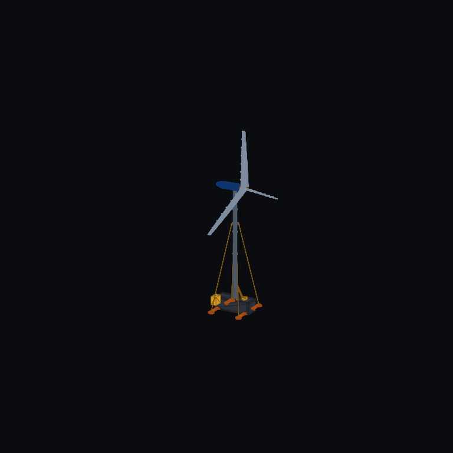 | 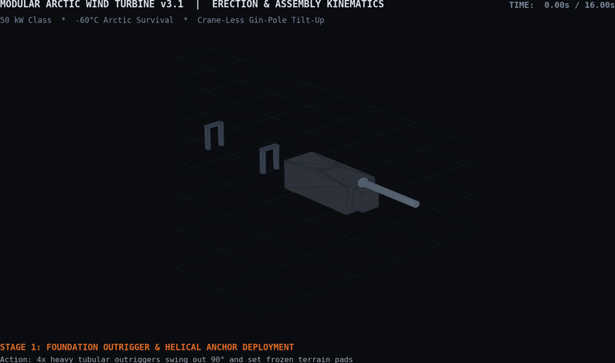 |
| *MP4 Video: [`modular_wind_turbine_v3_turntable.mp4`](cad/freecad/renders/modular_wind_turbine_v3_turntable.mp4)* | *MP4 Video: [`modular_wind_turbine_v3_erection.mp4`](cad/freecad/renders/modular_wind_turbine_v3_erection.mp4)* |

| **Cinematic Orbit (`v3.1`)** | **Cooperative Field Hoisting (`STRIDER-M` + `CORA-M` + Wind `v3.1`)** |
| :---: | :---: |
| 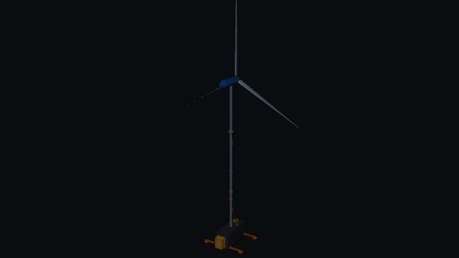 | 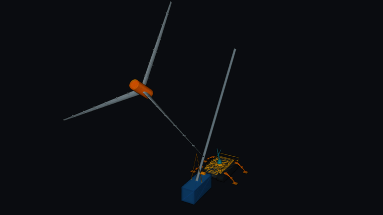 |
| *MP4 Video: [`modular_wind_turbine_v3_cinematic_v2.mp4`](cad/freecad/renders/modular_wind_turbine_v3_cinematic_v2.mp4)* | *MP4 Video: [`strider_cora_wind_hoist_cinematic_v2.mp4`](cad/freecad/renders/strider_cora_wind_hoist_cinematic_v2.mp4)* |

---

### 2. Five-Stage Field Deployment Sequence (`v3.1`)

| Stage 1: Outrigger & Footpad Deployment | Stage 2: Horizontal Mast Section Assembly | Stage 3: Nacelle & Segmented Rotor Docking |
| :---: | :---: | :---: |
|  |  | 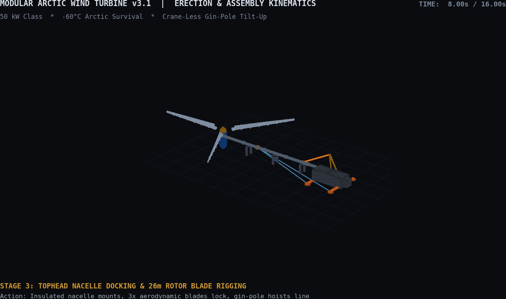 |

| Stage 4: Gin-Pole A-Frame Tilt-Up Arc ($45^\circ$) | Stage 5: Vertical Tensioning & Commissioning ($90^\circ$) | Cooperative Field Assembly Scene (Isometric) |
| :---: | :---: | :---: |
|  | 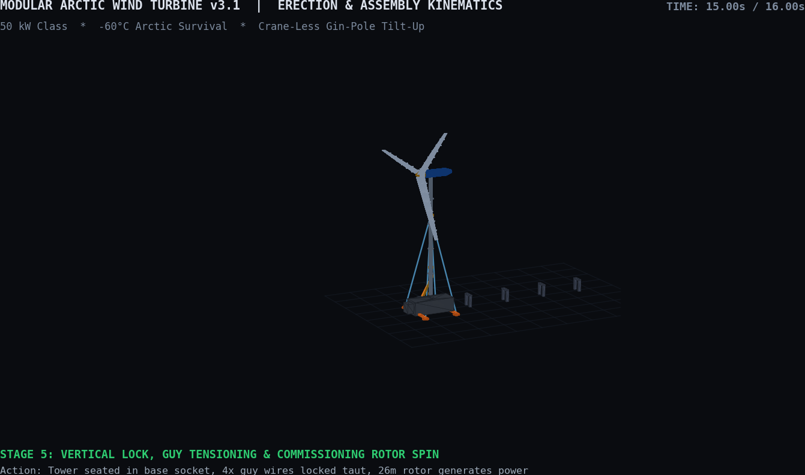 | 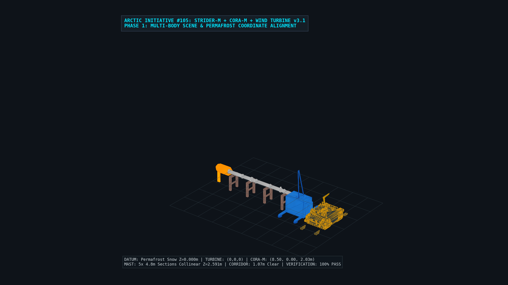 |

---

### 3. Six Core Hardware Subsystems (FreeCAD `v3.1` B-Rep Solids)

| **Package 1: Container Foundation & Outriggers** | **Package 2: Sectional Mast & Gin-Pole Rigging** | **Package 3: Direct-Drive PMSG Arctic Nacelle** |
| :---: | :---: | :---: |
|  | 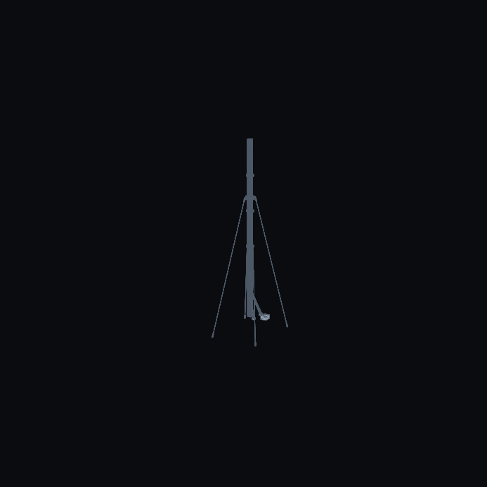 | 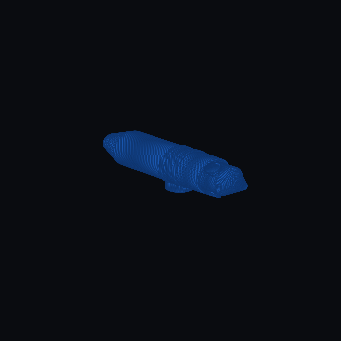 |
| [`wind_v3_foundation.py`](cad/freecad/components/wind_v3_foundation.py) | [`wind_v3_mast_erection.py`](cad/freecad/components/wind_v3_mast_erection.py) | [`wind_v3_nacelle.py`](cad/freecad/components/wind_v3_nacelle.py) |

| **Package 4: Segmented NACA Blade & Sleeve Joint** | **Package 5: 400V Hybrid Microgrid Cabinet** | **Package 6: 20 ft ISO Container Internal Stowage** |
| :---: | :---: | :---: |
|  | 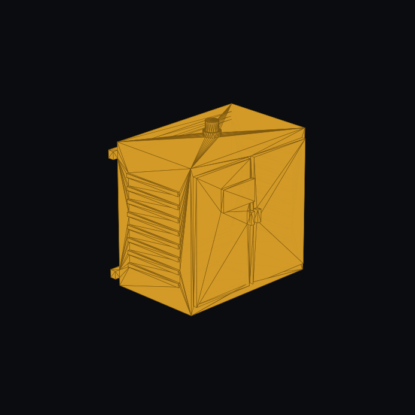 | 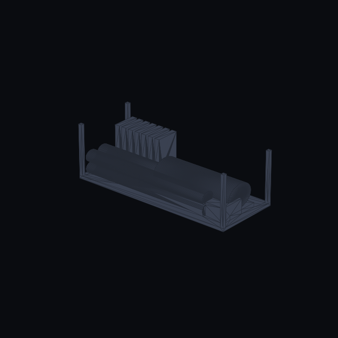 |
| [`wind_v3_blade_joint.py`](cad/freecad/components/wind_v3_blade_joint.py) | [`wind_v3_microgrid_cabinet.py`](cad/freecad/components/wind_v3_microgrid_cabinet.py) | [`wind_v3_container_stowage.py`](cad/freecad/components/wind_v3_container_stowage.py) |

---

### 4. Baseline `v2.0` OpenSCAD Operational & Unpacking Animations

| **Full 50 kW Rotor Operation (Landscape)** | **20 ft Container Unpacking Sequence** | **Gin-Pole Mast Tilt-Up (`v2.0`)** |
| :---: | :---: | :---: |
|  | 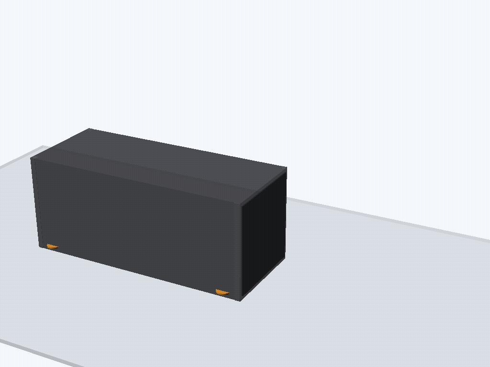 | 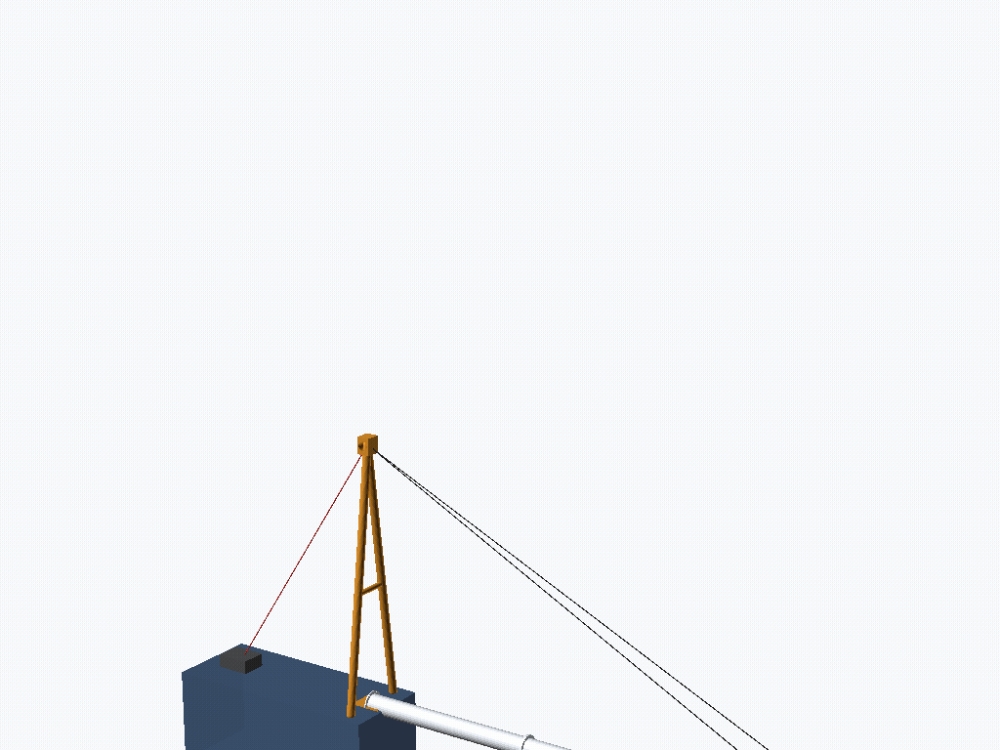 |
| *MP4: [`wind_v2_turbine_spinning_landscape.mp4`](cad/openscad/v2.0/wind_v2_turbine_spinning_landscape.mp4)* | *MP4: [`wind_v2_container_unpacking.mp4`](cad/openscad/v2.0/wind_v2_container_unpacking.mp4)* | *MP4: [`wind_v2_mast_erection.mp4`](cad/openscad/v2.0/wind_v2_mast_erection.mp4)* |

---

## 📂 Repository Layout

- [`cad/freecad/`](cad/freecad/): Parametric FreeCAD 1.0.0 Python B-Rep solid model generators (`modular_wind_turbine_v3.py`, `modular_wind_turbine_v2.py`), 6 subsystem modules (`components/`), and high-resolution renders/animations (`renders/`).
- [`cad/step_exports/`](cad/step_exports/): Monolithic ISO 10303 STEP solid models ([`modular_wind_turbine_v3.step`](cad/step_exports/modular_wind_turbine_v3.step) and [`modular_wind_turbine_v2.step`](cad/step_exports/modular_wind_turbine_v2.step)).
- [`cad/openscad/v2.0/`](cad/openscad/v2.0/): OpenSCAD visual assemblies and **12 analytical physics verification models**.
- [`cad/openscad/archive/v1.0/`](cad/openscad/archive/v1.0/): Historical `v1.0` vertical-axis / sail deflection studies and early prototypes.
- [`docs/specifications/`](docs/specifications/): Authoritative technical specification ([`modular_arctic_wind_architecture.md`](docs/specifications/modular_arctic_wind_architecture.md)).
- [`scripts/`](scripts/): Automated numerical verification test runner (`test_wind.sh`) and animation render scripts.

---

## 🧪 Quick Start: Automated 12-Model Physics Verification Suite

Run the complete 12-model numerical verification suite from the repository root:

```bash
./scripts/test_wind.sh
```

| # | Verification Script | Engineering Focus |
| :--- | :--- | :--- |
| **1** | [`envelope.py`](cad/openscad/v2.0/envelope.py) | Arctic Environmental & Air Density Envelope ($\rho = 1.656\text{ kg/m}^3$ at $-60\text{ }^\circ\text{C}$) |
| **2** | [`power_resource.py`](cad/openscad/v2.0/power_resource.py) | Power Resource Sizing & Betz Limit Audit ($50\text{ kW}$ at $10.5\text{ m/s}$) |
| **3** | [`container_sizing.py`](cad/openscad/v2.0/container_sizing.py) | ISO 20 ft Container Internal Geometry & Clearance Audit |
| **4** | [`foundation_load_envelope.py`](cad/openscad/v2.0/foundation_load_envelope.py) | Foundation Overturning Moment & Ballast Stability ($\text{FoS} \ge 1.75$) |
| **5** | [`erection_kinematics.py`](cad/openscad/v2.0/erection_kinematics.py) | Gin-Pole A-Frame Winch Line Tension & Pin Load Kinematics |
| **6** | [`powertrain_envelope.py`](cad/openscad/v2.0/powertrain_envelope.py) | Direct-Drive PMSG Electromagnetic & Thermal Nacelle Architecture |
| **7** | [`container_pack_audit.py`](cad/openscad/v2.0/container_pack_audit.py) | Complete 20 ft Container Payload Mass & Center-of-Gravity Audit ($9,216.8\text{ kg}$) |
| **8** | [`microgrid_dispatch.py`](cad/openscad/v2.0/microgrid_dispatch.py) | Annual Hourly Microgrid & Diesel Fuel Displacement ($21,087\text{ L/yr}$) |
| **9** | [`weibull_wind_resource.py`](cad/openscad/v2.0/weibull_wind_resource.py) | Weibull Wind Resource & Annual Energy Production (AEP) Matrix |
| **10** | [`aero_icing_loads.py`](cad/openscad/v2.0/aero_icing_loads.py) | Aerodynamic Storm Gust & Asymmetric Rime Icing Loads |
| **11** | [`cold_climate_fmea.py`](cad/openscad/v2.0/cold_climate_fmea.py) | Cold-Climate Subsystem FMEA (`IEC 60812`) |
| **12** | [`levelized_cost_energy.py`](cad/openscad/v2.0/levelized_cost_energy.py) | Arctic Levelized Cost of Energy (LCOE) vs. Diesel Baseline |
