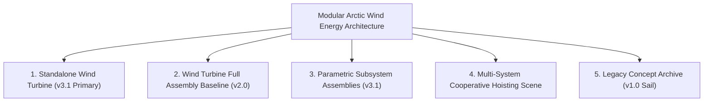
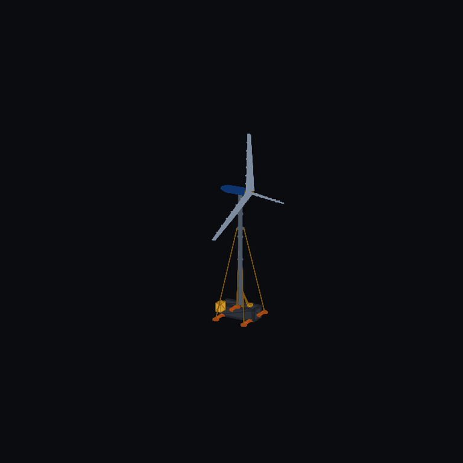
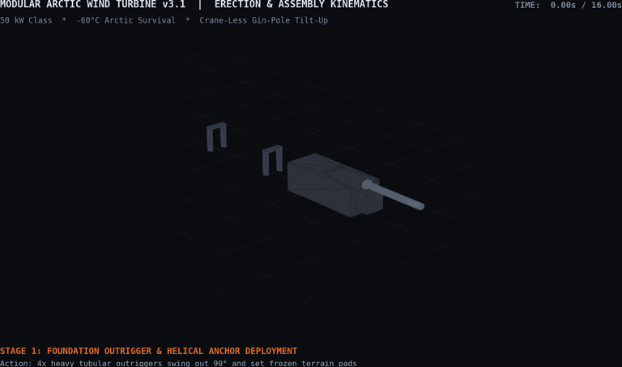
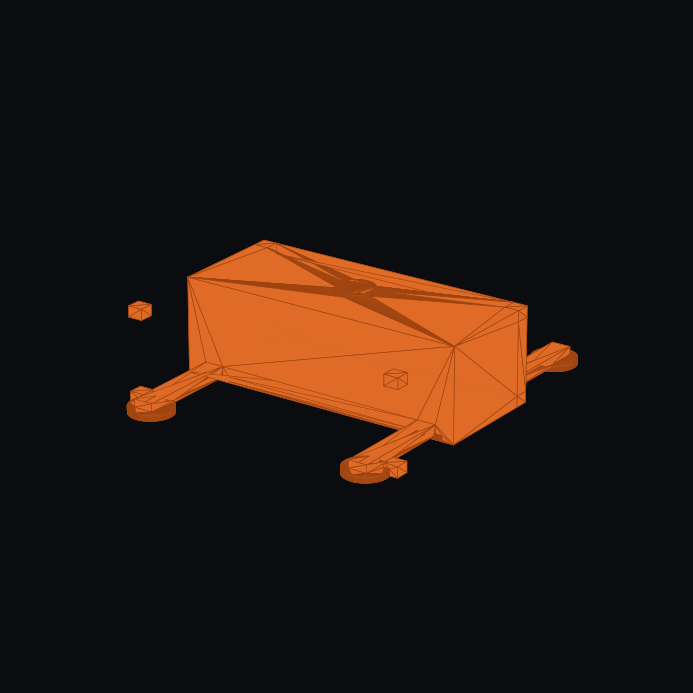
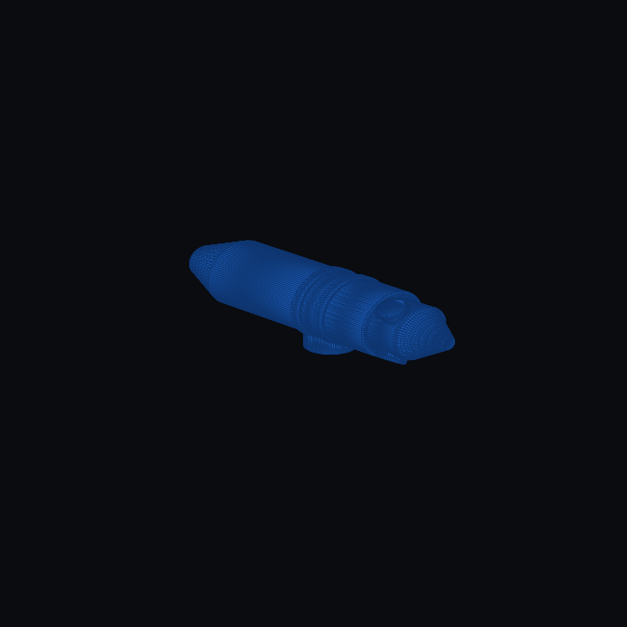
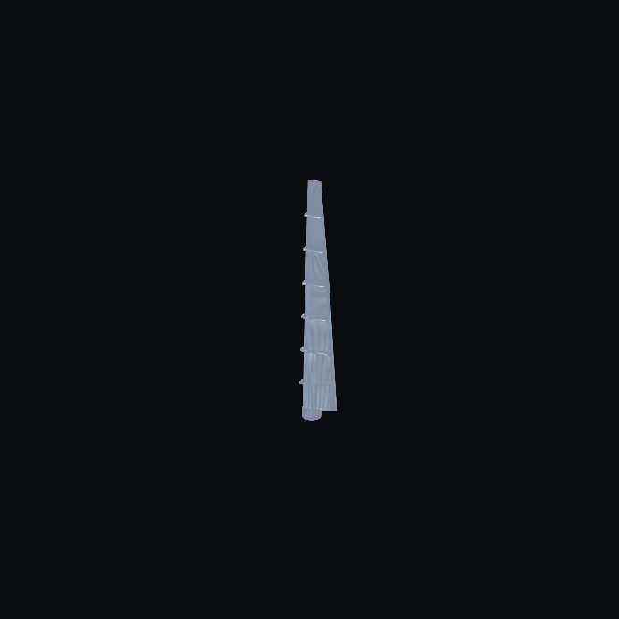
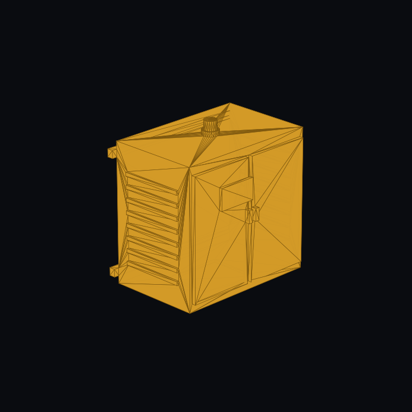
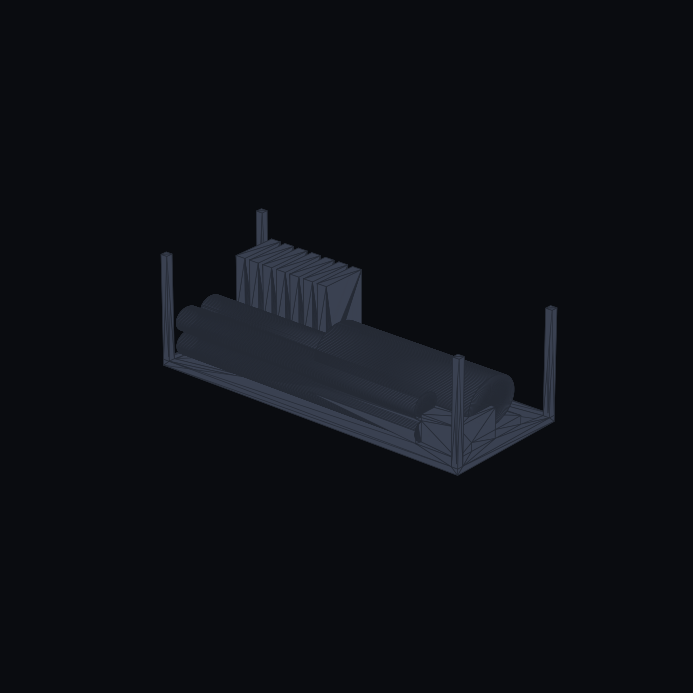
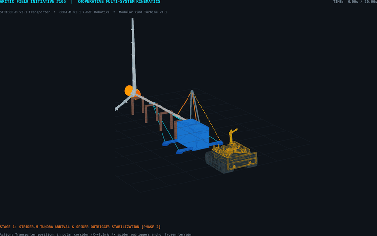
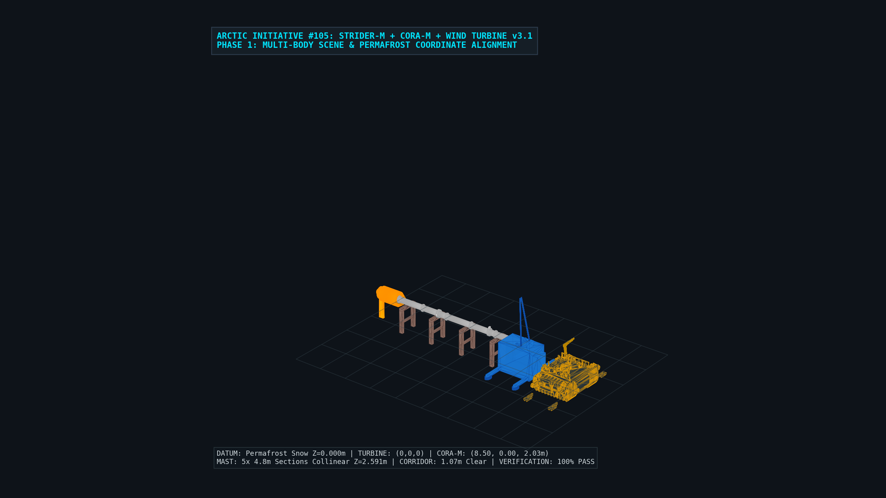

# Hardware Invention & Model Registry — Modular Arctic Wind Turbine

This registry serves as the authoritative technical catalog, dimensional specification sheet, and verification media ledger for the **Modular Arctic Wind Energy System** (`MAWT`).

---

## 🧭 Hardware Registry Index

---

## 1. Modular Arctic Wind Turbine System — `v3.1` (Primary Production)

| Specification Field | Technical Details |
| :--- | :--- |
| **Authoritative CAD** | • FreeCAD (`v3.1`): [`modular_wind_turbine_v3.py`](./freecad/modular_wind_turbine_v3.py) • STEP Solid (`v3.1`): [`step_exports/modular_wind_turbine_v3.step`](./step_exports/modular_wind_turbine_v3.step) (3.98 MB, 1,313 faces) • Architecture Spec: [`../docs/specifications/modular_arctic_wind_architecture.md`](../docs/specifications/modular_arctic_wind_architecture.md) |
| **Dimensions & Capacity** | Rated: $50\text{ kW}$ net electrical · Hub Height: $26.6\text{ m}$ ($24.0\text{ m}$ mast) · Rotor Diameter: $26.0\text{ m}$ |
| **Structural & Aero Architecture** | 28-pt NACA 4415/4418 aerodynamic lofted blades with 7 modular sleeve joint collars; direct-drive PMSG and rime-ice shedding cowl |
| **Hoisting & Foundation** | 20 ft ISO base sled with 4x deployable outriggers (helical drive caps & D-rings), 4-point guy wire collar with clevis lugs & turnbuckles ($z=16\text{ m}$), and container gin-pole A-frame winch with apex sheave & hoist line |
| **Verification Media** | • 360° Turntable (`v3.1`): [`freecad/renders/modular_wind_turbine_v3_turntable.gif`](./freecad/renders/modular_wind_turbine_v3_turntable.gif) · [`.mp4`](./freecad/renders/modular_wind_turbine_v3_turntable.mp4) • Cinematic Orbit (`v3.1`): [`freecad/renders/modular_wind_turbine_v3_cinematic.gif`](./freecad/renders/modular_wind_turbine_v3_cinematic.gif) · [`.mp4`](./freecad/renders/modular_wind_turbine_v3_cinematic.mp4) • Crane-Less Hoisting (`v3.1`): [`freecad/renders/modular_wind_turbine_v3_hoist.gif`](./freecad/renders/modular_wind_turbine_v3_hoist.gif) · [`.mp4`](./freecad/renders/modular_wind_turbine_v3_hoist.mp4) |

| FreeCAD 360° Turntable (`v3.1`) | Crane-Less Tilt-Up Hoisting (`v3.1`) |
| :---: | :---: |
|  |  |

---

## 2. Wind Turbine Full Assembly Baseline & Logistics — `v2.0`

| Specification Field | Technical Details |
| :--- | :--- |
| **Authoritative CAD** | • OpenSCAD Full Assembly (`v2.0`): [`openscad/v2.0/wind_v2_turbine_full.scad`](./openscad/v2.0/wind_v2_turbine_full.scad) • OpenSCAD Container Stowage (`v2.0`): [`openscad/v2.0/wind_v2_container_stowage.scad`](./openscad/v2.0/wind_v2_container_stowage.scad) • FreeCAD (`v2.0`): [`freecad/modular_wind_turbine_v2.py`](./freecad/modular_wind_turbine_v2.py) • STEP Solid (`v2.0`): [`step_exports/modular_wind_turbine_v2.step`](./step_exports/modular_wind_turbine_v2.step) |
| **Dimensions & Stowage** | Rated: $25\text{–}100\text{ kW}$ · Hub Height: $24.0\text{ m}$ · Rotor: $26.0\text{ m}$ · 20 ft ISO Container ($6.058\text{ m} \times 2.438\text{ m} \times 2.591\text{ m}$, payload $9,216.8\text{ kg} \le 10,886\text{ kg}$) |
| **Verification Media** | • 360° Turntable (`v2.0`): [`freecad/renders/modular_wind_turbine_v2_turntable.gif`](./freecad/renders/modular_wind_turbine_v2_turntable.gif) · [`.mp4`](./freecad/renders/modular_wind_turbine_v2_turntable.mp4) • Cinematic Orbit (`v2.0`): [`freecad/renders/modular_wind_turbine_v2_cinematic_v2.gif`](./freecad/renders/modular_wind_turbine_v2_cinematic_v2.gif) |

---

## 3. Parametric Subsystem Assembly Gallery (`v3.1`)

| Subsystem (`v3.1`) | CAD & STEP Solid | Architecture Summary | Render Preview (`v3.1`) |
| :--- | :--- | :--- | :---: |
| **Foundation Sled & Outriggers (`v3.1`)** | • [`freecad/components/wind_v3_foundation.py`](./freecad/components/wind_v3_foundation.py) • [`step_exports/wind_v3_foundation.step`](./step_exports/wind_v3_foundation.step) | 20 ft ISO sled, 8x corner castings, 4x deployable outriggers, ground pads ($R=0.45\text{ m}$), helical screw caps |  |
| **Mast & Hoist Rigging (`v3.1`)** | • [`freecad/components/wind_v3_mast_hoist.py`](./freecad/components/wind_v3_mast_hoist.py) • [`step_exports/wind_v3_mast_hoist.step`](./step_exports/wind_v3_mast_hoist.step) | 5-section tubular mast ($24.0\text{ m}$), guy collar ($z=16\text{ m}$), 4.2m gin-pole A-frame, apex sheave & winch |  |
| **Direct-Drive Nacelle & Hub (`v3.1`)** | • [`freecad/components/wind_v3_nacelle.py`](./freecad/components/wind_v3_nacelle.py) • [`step_exports/wind_v3_nacelle.step`](./step_exports/wind_v3_nacelle.step) | Direct-drive PMSG insulated nacelle ($\varnothing 1.35\text{ m} \times 3.40\text{ m}$), rime-ice tail cowl, hub barrel & nose cone |  |
| **NACA Aerodynamic Blade (`v3.1`)** | • [`freecad/components/wind_v3_blade_joint.py`](./freecad/components/wind_v3_blade_joint.py) • [`step_exports/wind_v3_blade_joint.step`](./step_exports/wind_v3_blade_joint.step) | 12.0m rotor blade lofted via 28-pt NACA 4415/4418 sections across 4 stations + 7 sleeve collars ($\le 1.90\text{ m}$) |  |
| **Arctic Microgrid Power Bay (`v3.1`)** | • [`freecad/components/wind_v3_microgrid_cabinet.py`](./freecad/components/wind_v3_microgrid_cabinet.py) • [`step_exports/wind_v3_microgrid_cabinet.step`](./step_exports/wind_v3_microgrid_cabinet.step) | NEMA 4X / IP66 enclosure ($0.90\text{ m} \times 1.40\text{ m} \times 1.80\text{ m}$), dual doors, HMI, 16x lateral heat-sink fins |  |
| **20 ft ISO Container Stowage (`v3.1`)** | • [`freecad/components/wind_v3_container_stowage.py`](./freecad/components/wind_v3_container_stowage.py) • [`step_exports/wind_v3_container_stowage.step`](./step_exports/wind_v3_container_stowage.step) | Intermodal stowage: 5x mast pipes, 21x blade sleeves in vertical cassettes, nacelle skid, and winch pack |  |

---

## 4. Multi-System Cooperative Field Hoisting Scene

| Specification Field | Technical Details |
| :--- | :--- |
| **Architecture & Kinematics** | World coordinate integration of **STRIDER-M `v2.1`**, **CORA-M `v1.1`**, and **Wind Turbine `v3.1`** on $Z = 0.000\text{ m}$ permafrost ground datum; 20-second (240 frames @ 12 fps) 5-stage simulation covering outrigger anchoring, mast offloading, sleeve coupling, gin-pole tilt-up, 90° masthead nacelle pitching, and vertical 26m rotor spin |
| **Verification Media** | • Full Animation (`v3.1`): [`freecad/renders/strider_cora_wind_hoist.gif`](./freecad/renders/strider_cora_wind_hoist.gif) · [`.mp4`](./freecad/renders/strider_cora_wind_hoist.mp4) • Phase 1 Stills (`v3.1`): [`freecad/renders/phase1_field_scene_isometric.png`](./freecad/renders/phase1_field_scene_isometric.png) · [`phase1_field_scene_top.png`](./freecad/renders/phase1_field_scene_top.png) · [`phase1_field_scene_side.png`](./freecad/renders/phase1_field_scene_side.png) |

| Cooperative Field Hoisting Animation (`v3.1`) | Phase 1 Multi-Body Field Scene Isometric (`v3.1`) |
| :---: | :---: |
|  |  |

---

## 5. Legacy Wind Concept Archive — `v1.0` (Two-Phase Thermal Sail)

The original proof-of-concept parametric two-phase thermal sail model is archived in [`openscad/archive/v1.0/`](./openscad/archive/v1.0/) for historical lineage and model reproduction benchmarks.
