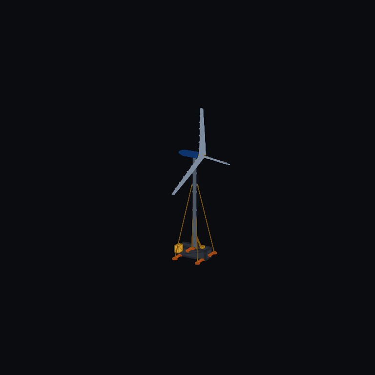
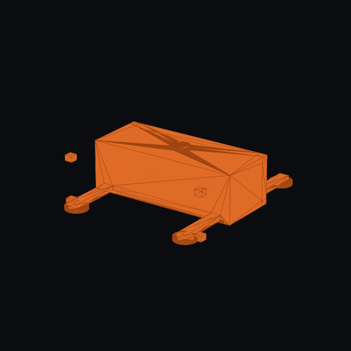
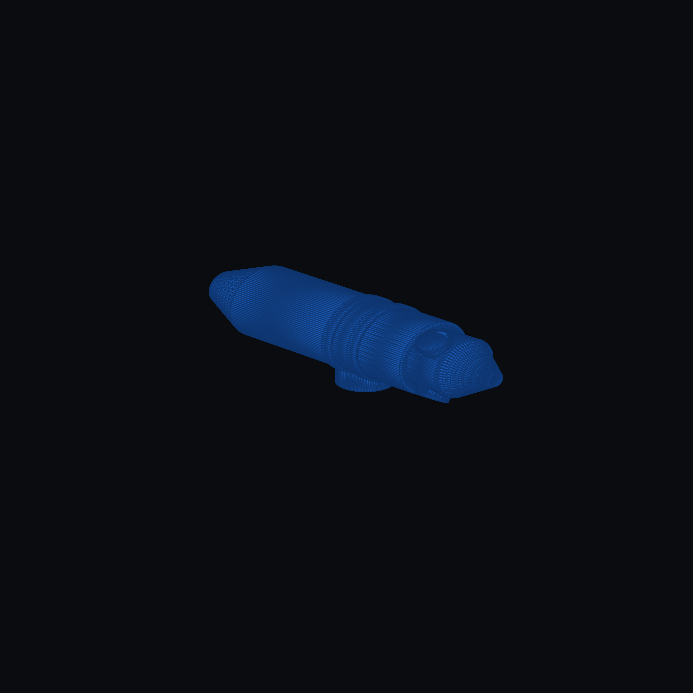
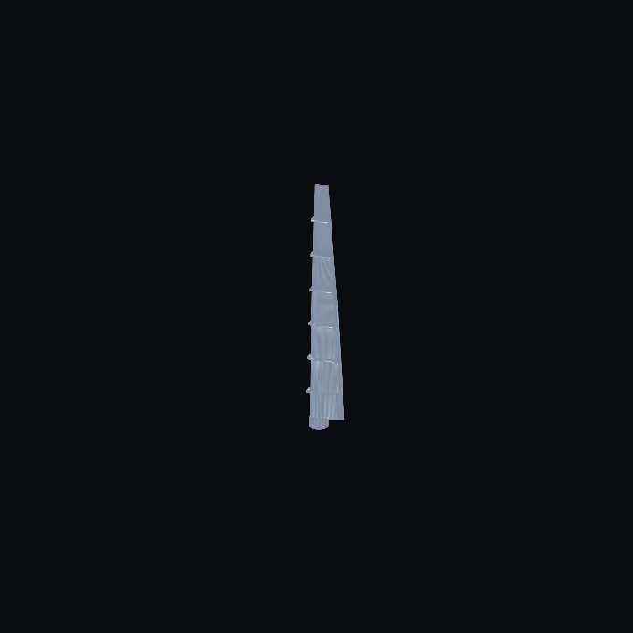
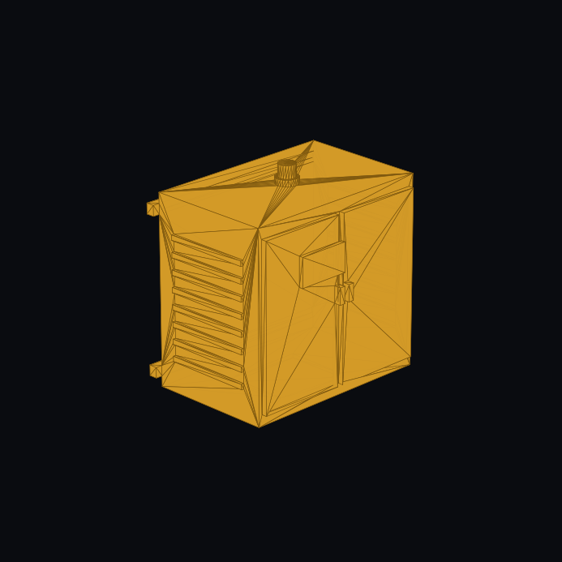
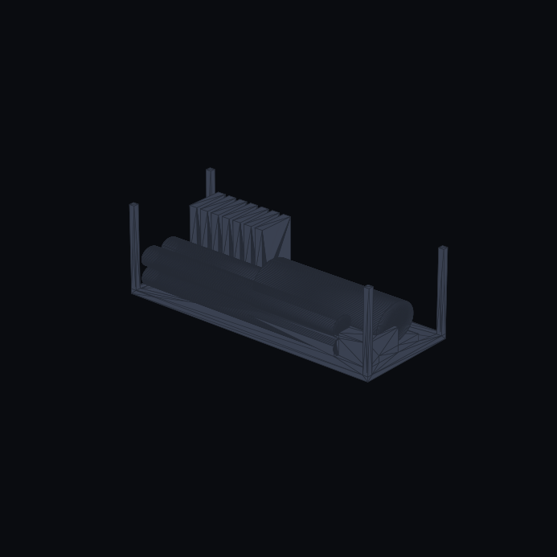

# FreeCAD Parametric CAD & Solid Model Engineering — Modular Arctic Wind Turbine

This directory contains native FreeCAD Python parametric scripts, components, renders, and solid models for the **Modular Arctic Wind Energy System** (`MAWT`).

---

## 📂 Directory Architecture

```
cad/freecad/
├── README.md                           # Navigation and model compilation guide
├── modular_wind_turbine_v2.py          # Full turbine v2.0 parametric assembly script
├── modular_wind_turbine_v3.py          # Primary production v3.1 parametric assembly script
├── components/                         # Parametric subsystem modules (v3.1)
│   ├── wind_v3_foundation.py           # 20 ft ISO base sled, outriggers & screw pile caps
│   ├── wind_v3_mast_hoist.py           # 5-section 24m tubular mast, gin-pole & winch
│   ├── wind_v3_nacelle.py              # PMSG direct-drive nacelle, hub barrel & cowl
│   ├── wind_v3_blade_joint.py          # 28-pt NACA 4415/4418 lofted blades & 7 sleeves
│   ├── wind_v3_microgrid_cabinet.py    # NEMA 4X / IP66 extreme-cold electrical enclosure
│   └── wind_v3_container_stowage.py    # Intermodal packing racks & cassette stowage
├── renders/                            # Photographic renders, turntables & animations
└── wind/                               # Symmetrical mirrored wind module tree
    ├── modular_wind_turbine_v2.py
    ├── modular_wind_turbine_v3.py
    ├── components/
    └── renders/
```

---

## 🎯 Authoritative Model Specifications

| System / Subsystem | Primary Script | Neutral STEP Export | Render Preview |
| :--- | :--- | :--- | :---: |
| **Modular Wind Turbine v3.1** | [`modular_wind_turbine_v3.py`](modular_wind_turbine_v3.py) | `cad/step_exports/modular_wind_turbine_v3.step` |  |
| **Foundation Sled & Outriggers** | [`components/wind_v3_foundation.py`](components/wind_v3_foundation.py) | `cad/step_exports/wind_v3_foundation.step` |  |
| **Mast & Gin-Pole Hoisting** | [`components/wind_v3_mast_hoist.py`](components/wind_v3_mast_hoist.py) | `cad/step_exports/wind_v3_mast_hoist.step` |  |
| **Direct-Drive Nacelle & Hub** | [`components/wind_v3_nacelle.py`](components/wind_v3_nacelle.py) | `cad/step_exports/wind_v3_nacelle.step` |  |
| **NACA Segmented Blade Joint** | [`components/wind_v3_blade_joint.py`](components/wind_v3_blade_joint.py) | `cad/step_exports/wind_v3_blade_joint.step` |  |
| **NEMA 4X Microgrid Cabinet** | [`components/wind_v3_microgrid_cabinet.py`](components/wind_v3_microgrid_cabinet.py) | `cad/step_exports/wind_v3_microgrid_cabinet.step` |  |
| **20 ft Container Stowage** | [`components/wind_v3_container_stowage.py`](components/wind_v3_container_stowage.py) | `cad/step_exports/wind_v3_container_stowage.step` |  |

---

## 🔨 Headless Batch Compilation

To compile parametric Python scripts into neutral ISO 10303 STEP solid models:

```bash
python3 scripts/export_all_step_models.py
```
