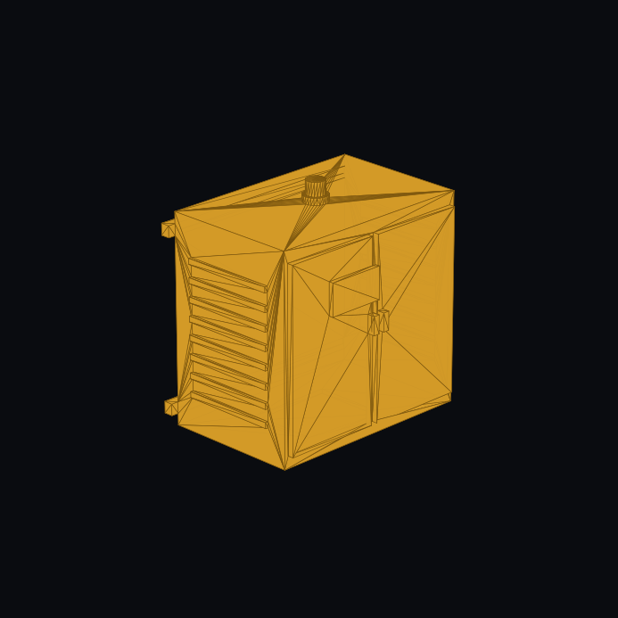

# Modular Arctic Wind — MIL-STD-461G Two-Way EMI Shielding, NEMA 4X (`IP66/IP68`) Microgrid Cabinet & 360° Braided Umbilical Armor

| Field | Detail |
| :--- | :--- |
| **System** | Modular Containerized Arctic Wind Turbine (`MAWT v3.1`) |
| **Subsystem** | Extreme-Cold Power Conversion Cabinet & 5-Layer Down-Tower Umbilical |
| **Authoritative CAD** | • FreeCAD: [`cad/freecad/components/wind_v3_microgrid_cabinet.py`](../../cad/freecad/components/wind_v3_microgrid_cabinet.py)<br>• STEP Solid: [`cad/step_exports/wind_v3_microgrid_cabinet.step`](../../cad/step_exports/wind_v3_microgrid_cabinet.step)<br>• Photographic Render: [`cad/freecad/renders/wind_v3_microgrid_cabinet.png`](../../cad/freecad/renders/wind_v3_microgrid_cabinet.png) |
| **Standards Compliance** | • Environmental: **NEMA 4X** · **IEC 60529 IP66 / IP68** (Watertight, dust-tight, salt-spray & ice-encased down to $-60\ ^\circ\text{C}$)<br>• Electromagnetic: **MIL-STD-461G** (Radiated/Conducted Emissions RE102, CE102 & Susceptibility RS103, CS101–CS116) |
| **Tracking Issue** | [#11 (Wind v3.1 Microgrid Cabinet NEMA 4X / MIL-STD-461G)](https://github.com/stellardreams/modular-arctic-wind/issues/11) |

---

## 1. Visual Subsystem Architecture: `wind_v3_microgrid_cabinet.png`



---

## 2. Two-Way Electromagnetic Shielding (`MIL-STD-461G`)

`MIL-STD-461G` (*Requirements for the Control of Electromagnetic Interference Characteristics of Subsystems and Equipment*) isolates both **outbound** emissions and **inbound** electromagnetic disturbances:

```text
+-------------------------------------------------------------------------+
|                NEMA 4X + MIL-STD-461G FARADAY CABINET                   |
|          (3.0 mm Welded 316L Stainless Steel + EMI Gaskets)             |
|                                                                         |
|   [ 50 kW SiC Inverter ] ---> [ Two-Stage Sine-Wave LC Choke ]          |
|            |                                 |                          |
|   1. BLOCKS OUTGOING NOISE:                  |  2. BLOCKS INCOMING      |
|      - RE102 (No radio waves leak out)       |     DISTURBANCES:        |
|      - CE102 (No power-wire buzz leaks out)  |     - RS103 (Survives    |
|      Protects remote radar stations,         |       200 V/m external   |
|      SATCOM & HF navigation links!           |       radar/RF fields)   |
|                                              |     - CS101-116 (Blocks  |
|                                              |       grid EMP/surges)   |
+-------------------------------------------------------------------------+
```

| Test Standard | Vector | Frequency / Level | Engineering Significance |
| :--- | :---: | :--- | :--- |
| **RE102** | **Outbound** (Radiated Emissions) | $10\text{ kHz – } 18\text{ GHz}$ | Prevents high-frequency switching harmonics from the 50 kW inverter and 24 m mast from leaking RF noise that could desensitize polar radar installations or HF/VHF/SATCOM communications. |
| **CE102** | **Outbound** (Conducted Emissions) | $10\text{ kHz – } 10\text{ MHz}$ | Prevents high-frequency common-mode ripple from traveling along the 400V AC microgrid distribution lines into sensitive scientific or community electronics. |
| **RS103** | **Inbound** (Radiated Susceptibility) | Up to $200\text{ V/m}$ ($2\text{ MHz – } 18\text{ GHz}$) | Ensures the turbine's PLC, sensors, and power electronics operate without corruption under intense external RF fields (e.g. sweeping search radar beams or high-power radio transmitters). |
| **CS101 / CS114 / CS115 / CS116** | **Inbound** (Conducted Susceptibility) | Damped sinusoids & fast transients | Hardens power inputs and signal lines against lightning-induced surges, diesel generator load dumps, and transient line pulses on the local microgrid. |

---

## 3. Industrial Enclosure Ratings (`NEMA 4X` & `IEC 60529 IP66 / IP68`)

- **NEMA 4X (North American Heavy Industrial Enclosure Rating)**:
  - **4 (Watertight & Ice-Proof)**: Completely seals against wind-driven tundra dust, driving sleet, high-pressure wash-down ($65\text{ GPM}$ @ $1\text{ in.}$ nozzle), and remains undamaged when encapsulated in external rime ice.
  - **X (Corrosion Resistance)**: Fabricated from laser-welded **316L marine-grade stainless steel** to resist severe coastal marine salt atmospheres for $20+$ years without seam degradation.
- **International IEC 60529 IP66 / IP68 Equivalence**:
  - Full dust tightness (**IP6X**) plus continuous high-pressure water jets / complete submersion resistance (**IPX6/IPX8**) utilizing closed-cell fluorosilicone/beryllium-copper conductive perimeter gaskets.

---

## 4. Concentric 5-Layer 360° Grounded Braided Down-Tower Umbilical Armor

When 50 kW of 3-phase power travels down the 24 m mast from the nacelle to the base container cabinet, an unshielded cable would turn the tower into a monopole antenna. In polar conditions, exposed synthetic insulation is vulnerable to animal chewing (Arctic foxes, polar bears), windblown crystal abrasion, and low-temperature flex cracking at $-60\ ^\circ\text{C}$.

```text
           CROSS-SECTION OF 360° BRAIDED DOWN-TOWER UMBILICAL CABLE
           ========================================================

                     . - ~ ~ ~ - .
                 . '   Layer 5     ' .      <-- Layer 5: Outer 316L Stainless Steel
               /   . - ~ ~ ~ ~ - .     \        Mechanical Mesh Armor (Animal bite,
              /  /    Layer 4      \    \       ice abrasion & crush protection)
             |  |   . - ~ ~ ~ - .   |    |
             |  |  |  Layer 3    |  |    |  <-- Layer 4: Arctic Fluorosilicone / EPR
             |  |  |  (3x 400V   |  |    |      Cryo Jacket (Flexible down to -70 °C)
             |  |  |   Phase +   |  |    |
             |  |  |  Fiber/CAN) |  |    |  <-- Layer 3: Inner Tinned-Copper + Mu-Metal
              \  \   ' - _ _ - '   /    /       Dense Double-Braided Faraday Shield
               \   ' . _ _ _ _ . '     /        (>95% optical coverage, blocks EMI)
                 ' .               . '
                     ' - ~ ~ ~ - '
                           |
                           v
        Terminated at BOTH ends via 360° Iris/Cone EMC Compression Glands
        bolted directly to Nacelle Housing & NEMA 4X Cabinet Ground Bus!
```

1. **360° Continuous Circumferential Termination**:
   - Omits pigtail grounding wires (which act as inductors at frequencies $>10\text{ MHz}$).
   - Employs **360° EMC iris compression glands** bonding the braided shield directly to the cabinet wall, shunting high-frequency currents radially to the outer chassis skin and down to the helical screw ground piles.
2. **Dual-Mesh Synergistic Layers**:
   - **Inner Shield (Tinned Copper / Nickel Mesh)**: $>95\%$ optical coverage draining common-mode electrical harmonics (`CE102`/`RE102`).
   - **Outer Armor (316L Austenitic Stainless Steel Braid)**: Austenitic FCC crystal structure maintains ductile toughness at $-60\ ^\circ\text{C}$ without brittle transition, flexing smoothly across the mast hinge trunnion during tilt-up while resisting wildlife bite and crush hazards.
