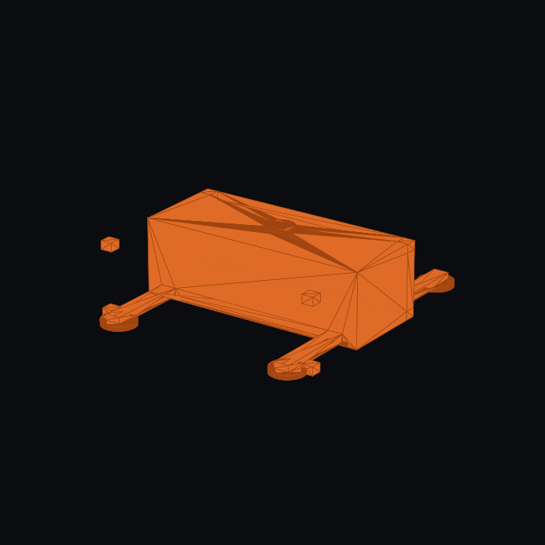

# Modular Arctic Wind — Permafrost Foundation, Thermo-Siphon & Ballast Architecture

| Field | Detail |
| :--- | :--- |
| **System** | Modular Containerized Arctic Wind Turbine (`MAWT v3.1`) |
| **Subsystem** | 4-Part Permafrost Ground Foundation, Outriggers & Cryo-Composite Ballast |
| **Authoritative CAD** | • FreeCAD: [`cad/freecad/components/wind_v3_foundation.py`](../../cad/freecad/components/wind_v3_foundation.py)<br>• STEP Solid: [`cad/step_exports/wind_v3_foundation.step`](../../cad/step_exports/wind_v3_foundation.step)<br>• Photographic Render: [`cad/freecad/renders/wind_v3_foundation.png`](../../cad/freecad/renders/wind_v3_foundation.png) |
| **Physics Verification** | Direct torque helical anchor pull-out envelope ($85\text{ kN}$), $120\text{ kN}$ jack-out breakout collar, and passive $\text{CO}_2$ two-phase thermosiphon ground chilling loop |
| **Tracking Issue** | [#9 (Formearth & Polar Turbine Foundation Ballast Concepts)](https://github.com/stellardreams/modular-arctic-wind/issues/9) |

---

## 1. Visual Subsystem Architecture: `wind_v3_foundation.png`



---

## 2. Integrated 4-Part Permafrost Foundation Architecture

```text
                  [ 24.0 m Wind Turbine Mast ]
                               |
     +=========================+=========================+
     |    20 ft Container Sled + Internal Ballast Bays   |
     |  [ Filled with 2,157 kg Local Gravel + Snow/Ice   |
     |    Cryo-Composite frozen by Thermo-Siphon Loop ]  |
     +=========================+=========================+
       /     (150 mm Thermal Insulation Pad)           \
      / Outrigger Arm                     Outrigger Arm \
  +-------+  <-- 120 kN Jack-Out Collar             +-------+
  |Pad 0.9m| <-- 15° Beveled UHMW-PE Anti-Stick Rim |Pad 0.9m|
==+===+===+=========================================+===+===+==  <-- Ground Surface (Z = 0.0 m)
      |   |   ACTIVE LAYER (0.0 m to -1.2 m):           |   |
      |   |   Freezes in winter, thaws to mud in July   |   |
------+---+---------------------------------------------+---+--  <-- Permafrost Table (Z = -1.2 m)
      |   |   PERMANENTLY FROZEN PERMAFROST (< -1.2 m): |   |
     /=====\  <-- Helical Screw Pile Blades (1.8 m deep)/=====\
      |   |       (Holds 85 kN pullout; unscrews in      |   |
     /=====\       15 mins when relocating!)            /=====\
      |CO2|   <-- Passive Thermo-Siphon Tube:            |CO2|
      +---+       Pumps winter cold (-50 °C) down;       +---+
                  stops summer heat from going down!
```

---

## 3. Resolving Sinking & Adfreeze Locking (Jack-Out Footpad Mechanism)

During the high-latitude summer thaw (July–August), the top $0.5\text{ m–}1.2\text{ m}$ active permafrost layer softens into saturated muskeg/silt. If flat steel outrigger pads sink $10\text{–}20\text{ cm}$ and subsequent sub-zero temperatures arrive in September ($-40\ ^\circ\text{C}$), **adfreeze bond stress** ($200\text{–}400\text{ kPa}$ on bare steel) locks the pads into the ground.

To ensure pads **never sink uncontrollably** and **pop free effortlessly** during relocation, three mechanical and thermal countermeasures are implemented:

```text
         ANTI-SINK & ANTI-ADFREEZE JACK-OUT FOOTPAD DETAIL
         =================================================

                     Outrigger Clevis Arm
                             |  |
                  +----------+--+----------+
                  |  Double-Acting Acme /  | <-- 1. JACK-OUT EXTRACTION COLLAR:
                  |  Hydraulic Jack Screw  |     Pushing against the central screw pile
                  +----------+--+----------+     lifts the pad UP with 120 kN (27,000 lbf)!
                             |  |
             ================+==+================
            /     Steel Structural Dome          \
           /   [ Perimeter CNT Thermal-Break ]    \ <-- 2. 10-Min +2 °C Pulse melts ice skin
          /________________________________________\
          \      15° Beveled UHMW-PE Liner         / <-- 3. Hydrophobic UHMW-PE + 15° Cone:
           \______________________________________/     Ice cannot bond; angled sides release
                       ||            ||                 immediately on upward lift!
                       || Screw Pile ||
                       ||  Through-  ||
                       ||   Sleeve   ||
```

1. **$15^\circ$ Beveled Frustum with Hydrophobic UHMW-PE Base Liner**:
   - Bare steel exhibits severe ice adhesion ($\sim 250\text{–}400\text{ kPa}$). Lining the bottom and $15^\circ$ sloped sides of the $0.90\text{ m}$ footpad with Ultra-High-Molecular-Weight Polyethylene (UHMW-PE) slashes adfreeze bond strength by $>90\%$ ($<20\text{ kPa}$).
   - The $15^\circ$ draft angle breaks perimeter shear bonding within the first $2\text{ mm}$ of vertical travel.
2. **Double-Acting Jack-Out Extraction Collar ($120\text{ kN}$ Breakout Force)**:
   - Each outrigger vertical leveling jack couples via a reaction collar to the helical screw pile sleeve. Before unscrewing the pile, reversing the jack uses the anchored pile as a reaction post to drive the pad straight upward with $120\text{ kN}$ ($27,000\text{ lbf}$) of breakout force.
3. **Perimeter Thermal-Release Heating Element ($+2\ ^\circ\text{C}$ for 10 min)**:
   - A $300\text{ W}$ resistive heating loop embedded in the footpad perimeter warms the boundary layer to $+2\ ^\circ\text{C}$ before disassembly, melting any micro-ice bond with zero mechanical prying.

---

## 4. Passive $\text{CO}_2$ Two-Phase Thermo-Siphon Dynamics

Natural buoyancy convection requires **zero pumps, zero moving parts, and zero external electrical power**:

| Operational Phase | Environmental Condition | Thermosiphon Physics & Fluid Dynamics |
| :--- | :--- | :--- |
| **Arctic Winter Regime** | Air: $-30\ ^\circ\text{C}\text{ to } -60\ ^\circ\text{C}$<br>Sub-surface: $-2\ ^\circ\text{C}$ | Ground heat evaporates liquid $\text{CO}_2$ at pile depth ($1.8\text{ m}$). Vapor rises to above-ground condenser fins, transfers heat to freezing ambient air, condenses to liquid, and returns via gravity. Actively sub-cools permafrost table to $-15\ ^\circ\text{C}$. |
| **Arctic Summer Regime** | Air: $+15\ ^\circ\text{C}$<br>Sub-surface: $-10\ ^\circ\text{C}$ | Condenser head is warmer than evaporator sump. Warm vapor remains buoyant at top; dense liquid rests at bottom. Convection halts completely (**thermal diode action**), preventing summer ambient heat conduction down into permafrost. |

---

## 5. In-Situ Cryo-Composite Ballast & Formearth Binders

1. **Immediate Modular Field Method (Local Cryo-Composite Monolith)**:
   - Eliminates flying $2,157\text{ kg}$ of ready-mix concrete payload.
   - Crew or autonomous loader fills container base ballast trays with local gravel, crushed aggregate, and snow/water.
   - An evaporator branch loop from the passive $\text{CO}_2$ thermosiphon freezes the mixture into a reinforced **Cryo-Composite Monolith** (density $\sim 2,100\text{–}2,300\text{ kg/m}^3$, compressive strength $>15\text{–}25\text{ MPa}$ below $-10\ ^\circ\text{C}$, exceeding residential structural concrete).
2. **Advanced Low-Temperature Geopolymer Binder Research**:
   - Formearth ambient-cured aluminosilicate binders utilize local mineral aggregates activated at low temperatures without Portland cement kilns.
   - Formalized under [Issue #9](https://github.com/stellardreams/modular-arctic-wind/issues/9) for post-baseline material characterization and long-term freeze-thaw lifecycle modeling.
